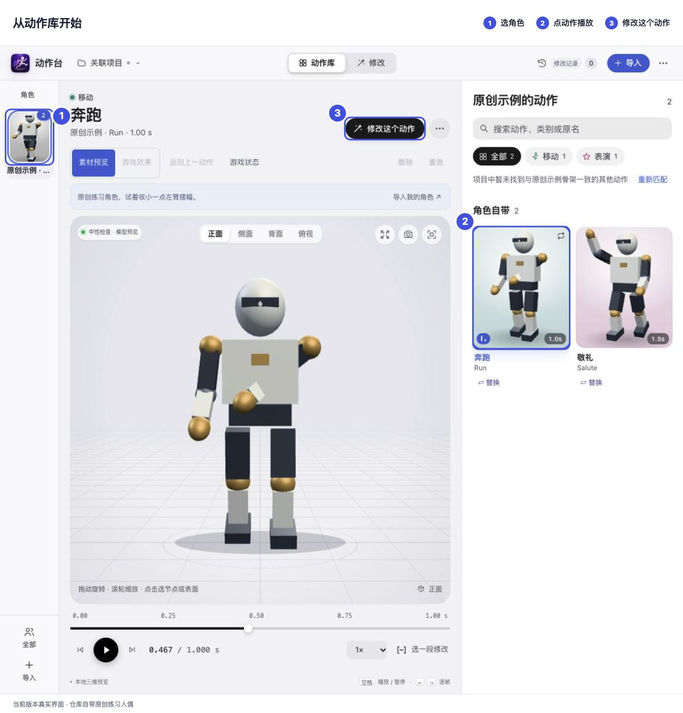
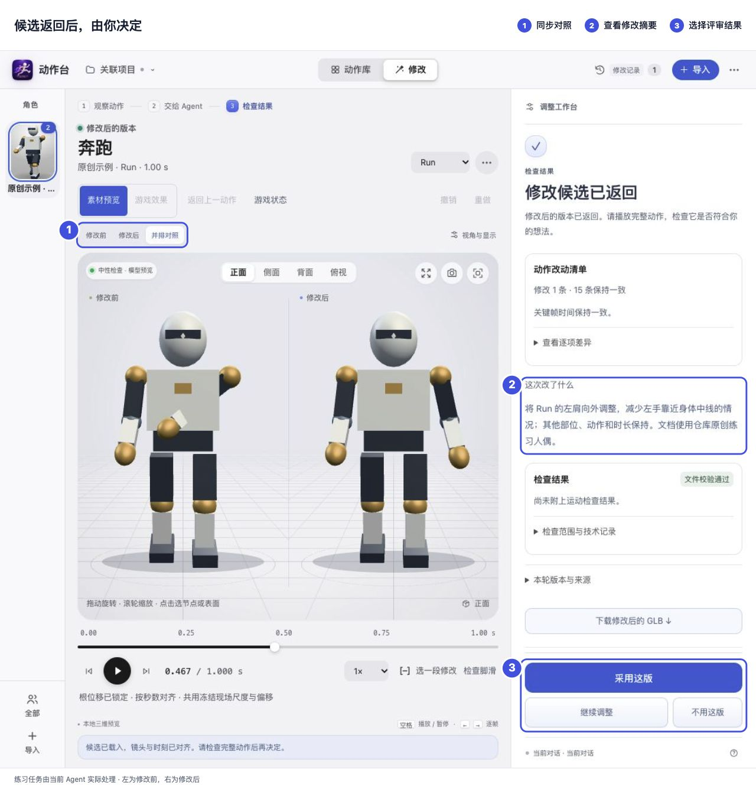

# 动作台 MotionStage

在本机浏览器里查看 3D 角色和动作，暂停、标记问题，交给 AI Agent 修改，再把候选与原版并排比较。

支持 GLB / FBX、兼容动作匹配、脚滑检查和多处画面标记。界面为中文。

## 快速开始

需要 **Node.js 22+** 和支持 **WebGL2** 的浏览器。运行时已随包提供，无需 `npm install`；预览和本地微调不需要 API Key。

```sh
git clone https://github.com/jbang2004/motion-stage.git
cd motion-stage
node skill/scripts/start.mjs
```

也可进入 `skill/`，macOS 双击 `Open MotionStage.command`，Windows 双击 `Open MotionStage.cmd`。
首次启动自带练习人偶，自动打开浏览器；保持终端运行，`Ctrl+C` 停止。

直接打开自己的游戏项目（在仓库根目录运行）：

```sh
node skill/scripts/start.mjs --project "/absolute/path/to/game"
```

## 怎么用



1. **选角色和动作**：点左上角「关联项目」，或用「＋导入」添加模型；在动作库点卡片播放。GLB 可直接查看，FBX 另需本机 Blender 4.2+。
2. **提出修改**：点「修改这个动作」，暂停到问题时刻，选部位并写要求。多处问题可逐一「标记当前画面」，一起提交。
3. **交给 Agent**：默认保存后复制任务到当前对话；也可选「本机后台处理」，使用已配置的 Codex CLI、Claude Code 或 DeepSeek Harness。保存任务后，需有 Agent 领取才会执行。
4. **比较结果**：同一时刻、同一镜头查看修改前后，选择「采用这版」「继续调整」或「不用这版」。认可后需要放进游戏，再点「接入游戏…」交给 Agent。



想先体验流程，可展开「本地微调」，调整摆幅或旋转偏移，试播后生成候选。

项目素材与记录保存在 `<项目>/.motion-studio/`；独立练习默认在 `~/motion-stage-workspace/`。候选单独保存，采用后仍需另行接入游戏。不同骨架的动作需要重定向；普通预览不包含游戏里的布料、IK 或战斗逻辑。

## 安装为 Agent Skill

在仓库根目录运行，选择对应客户端的安装命令（目标目录须不存在）：

```sh
# Codex
node skill/scripts/motion-feedback.mjs install --target "$HOME/.codex/skills/motion-stage"
# Claude Code
node skill/scripts/motion-feedback.mjs install --target "$HOME/.claude/skills/motion-stage"
```

Windows PowerShell 将 `$HOME` 换为 `$env:USERPROFILE`。安装后新开对话，例如「使用 $motion-stage 打开当前项目的动作库」。其他能运行本机工具的 Agent 可按 [SKILL.md](skill/SKILL.md) 使用 CLI / stdio MCP。

## 按需查阅

- [安装、导入与排错](skill/references/setup.md)
- [动作库](skill/references/action-library.md) · [项目工作区](skill/references/project-workspace.md)
- [Agent 任务流程](skill/references/agent-workflow.md) · [接入游戏](skill/references/game-integration.md) · [游戏效果预览](skill/references/runtime-preview.md)

## 开发

源码和完整 Skill 都在 `skill/`，无需构建。仓库根目录运行：

```sh
npm --prefix skill test
python3 tools/package-skill.py
```

修改 `skill/` 后需重新打包，并同步 `skill/bundle-manifest.json` 和 `release.json`。发行包在 `dist/`；[CI 说明](tools/ci/README.md)。

## 交流群

微信群 **AI 大航海时代**，扫码加入。本次二维码标注 **11 月 18 日前有效**。


## 许可

代码与原创练习资源采用 [MIT](skill/LICENSE)，随包运行时见 [第三方许可](skill/THIRD_PARTY.md)。不包含私人游戏角色或商用动作包。
