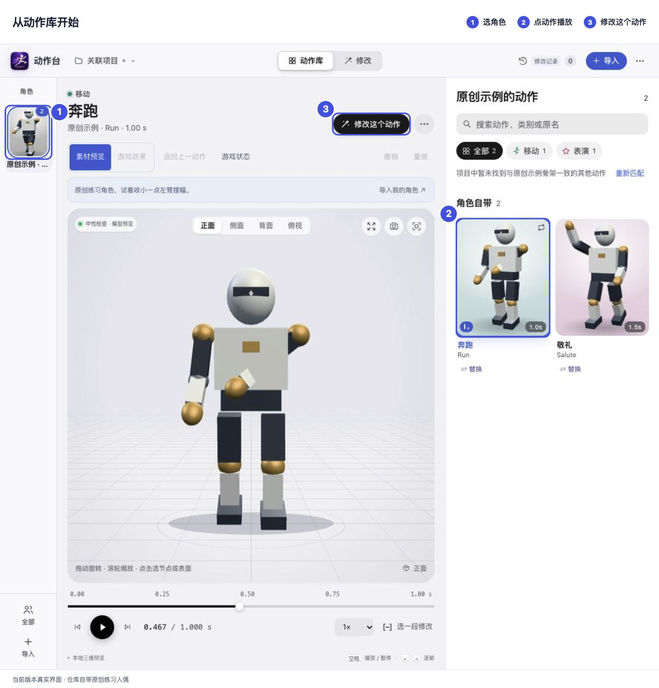
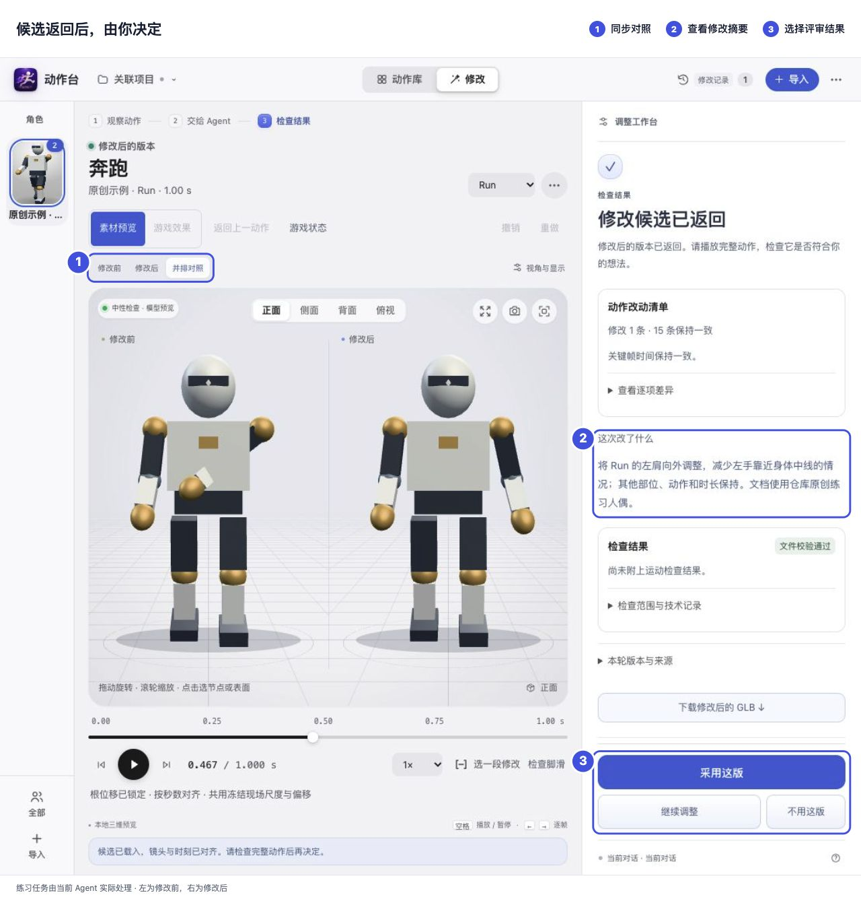

# 动作台 MotionStage

本地 3D 角色动作工作台：查看动作、标记问题、交给 Agent 修改，再并排比较原版和候选。

## 启动

需要 **Node.js 22+** 和支持 **WebGL2** 的浏览器，无需 `npm install`。在本文件所在目录运行：

```sh
node scripts/start.mjs
```

macOS 也可双击 `Open MotionStage.command`，Windows 双击 `Open MotionStage.cmd`。首次启动自带练习人偶；保持终端运行，`Ctrl+C` 停止。

打开自己的项目：

```sh
node scripts/start.mjs --project "/absolute/path/to/game"
```

项目记录保存在 `<项目>/.motion-studio/`；独立练习默认在 `~/motion-stage-workspace/`。

## 使用



1. 「关联项目」或「＋导入」添加角色，在动作库点卡片播放。GLB 直接查看；FBX 需要本机 Blender 4.2+。
2. 点「修改这个动作」，暂停、选部位、写要求；多处问题可逐一「标记当前画面」。
3. 保存后复制任务给当前 Agent 对话，或选「本机后台处理」，使用已配置的 Codex CLI、Claude Code 或 DeepSeek Harness。
4. 候选返回后并排比较，选择「采用这版」「继续调整」或「不用这版」。放进游戏需另点「接入游戏…」。



无需 AI 也能展开「本地微调」，试播摆幅或旋转偏移并生成候选。不同骨架需要重定向；正式效果仍需在游戏中检查。

## 安装成 Skill（可选）

在本文件所在目录运行，目标目录须不存在：

```sh
node scripts/motion-feedback.mjs install --target "$HOME/.codex/skills/motion-stage"
```

Claude Code 将目标换为 `$HOME/.claude/skills/motion-stage`；Windows PowerShell 将 `$HOME` 换为 `$env:USERPROFILE`。安装后新开对话调用 `$motion-stage`。

## 文档

- [安装与排错](references/setup.md) · [动作库](references/action-library.md) · [项目工作区](references/project-workspace.md)
- [Agent 入口](SKILL.md) · [任务流程与 CLI / MCP](references/agent-workflow.md)
- [接入游戏](references/game-integration.md) · [游戏效果预览](references/runtime-preview.md)

## 交流群

微信群 **AI 大航海时代**，扫码加入。本次二维码标注 **11 月 18 日前有效**。


代码与原创练习资源见 [MIT 许可](LICENSE)，随包运行时见 [第三方许可](THIRD_PARTY.md)。
